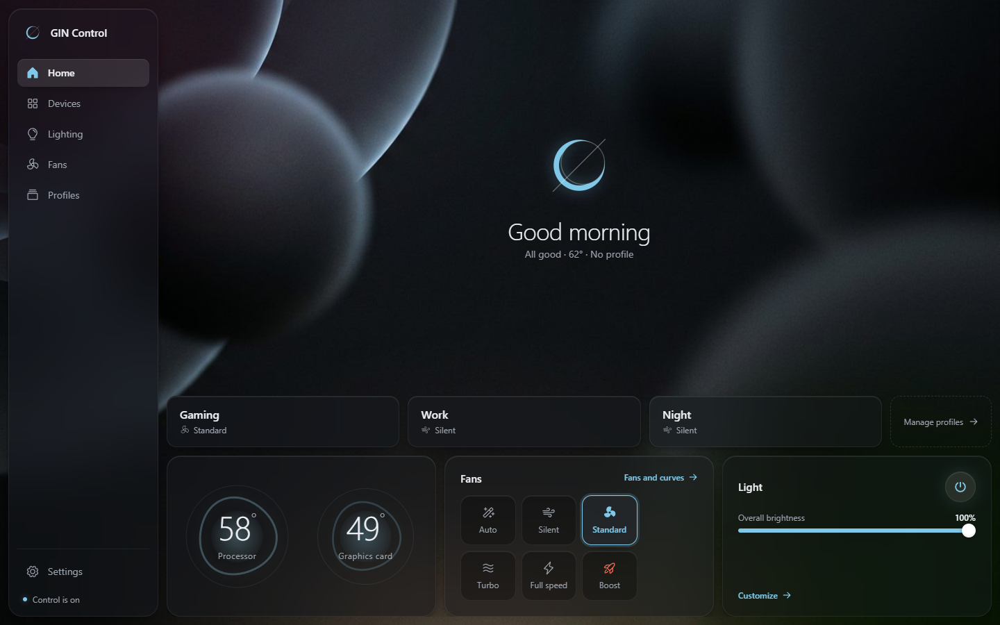
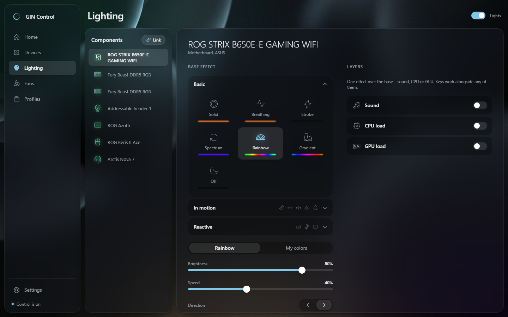
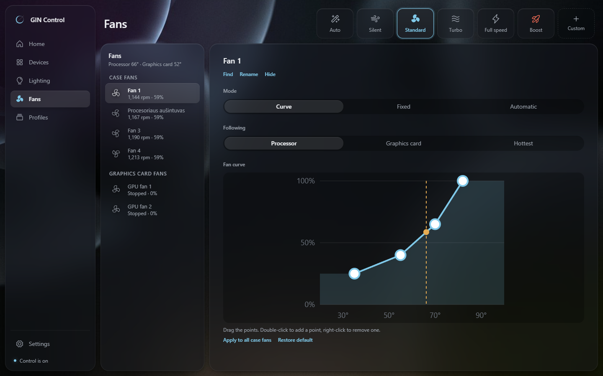
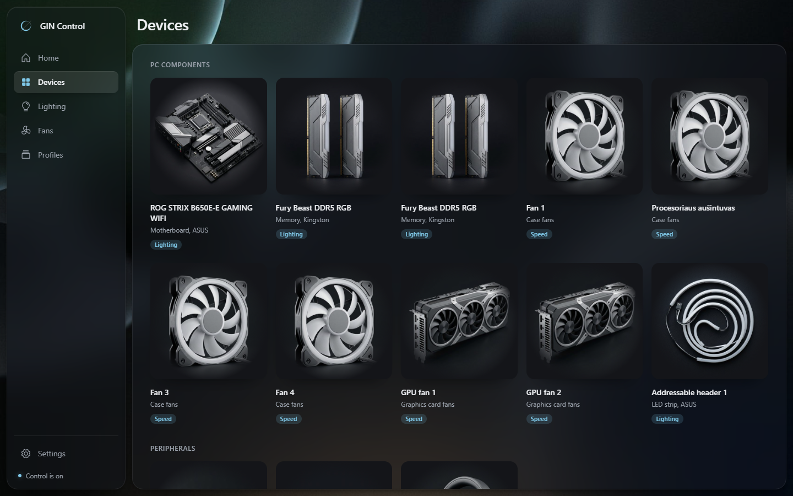
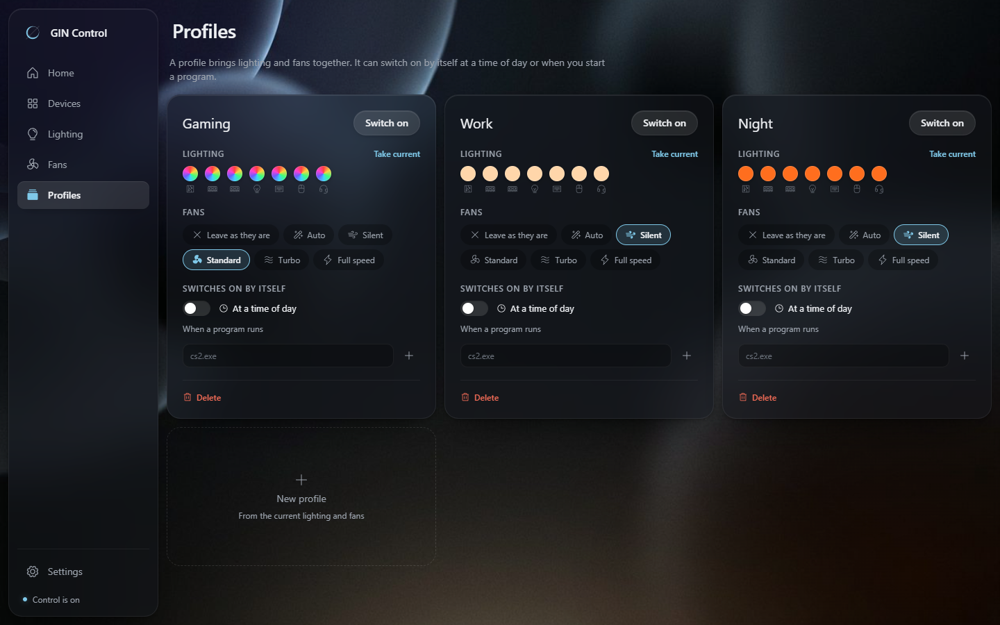
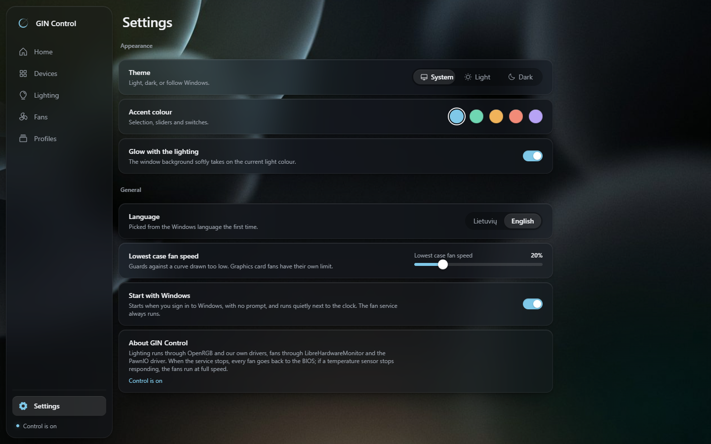

# GIN Control

GIN Control is a lightweight Windows desktop app that brings PC lighting and
fan control into one place. It can coordinate RGB effects across supported
devices, manage per-fan curves and modes, and switch lighting and fan settings
with profiles.

> **BETA — fan control can affect hardware temperatures.** Monitor your system
> after installation and after every fan-curve change. Unsupported devices,
> incorrect settings, or software failures can cause overheating or hardware
> damage. Use at your own risk.



## Download

[Download the latest Windows installer](https://github.com/G1NiS/gin-control-releases/releases/latest/download/GIN-Control-1.0.1-x64-setup.exe)

Current release: **GIN Control 1.0.1 Beta**

SHA-256:

```text
A5D1ACEF8B6F73DF2FEDDE0876315D0AF0E4184A2A9538ABDFE9DE00AAB868BE
```

You can verify the downloaded installer in PowerShell:

```powershell
Get-FileHash .\GIN-Control-1.0.1-x64-setup.exe -Algorithm SHA256
```

Requirements: Windows 10 or Windows 11, x64. The installer includes the
required GIN Control service and runtime components.

The installer is not code-signed yet. Windows SmartScreen may show a warning.
If you downloaded the installer from this repository, choose **More info** and
then **Run anyway** to continue.

The installer displays the beta end-user license and requires acceptance
before installation continues.

## What it controls

- Motherboard, RAM, ARGB, GPU, keyboard, mouse, headset, and other supported
  lighting devices
- Synchronized lighting effects, layers, and per-key painting on supported
  keyboards
- Fan curves and Auto, Silent, Standard, Turbo, Full speed, Custom, and Boost
  modes
- Up to five profiles with optional time- or app-based switching

| Lighting | Fans |
|---|---|
|  |  |
| **Devices** | **Profiles** |
|  |  |



## Feedback and support

GIN Control is in public beta. Reports from different motherboards, fan
controllers, and RGB devices are especially useful.

- [Report a reproducible bug](https://github.com/G1NiS/gin-control-releases/issues/new?template=bug_report.yml)
- [Report an undetected device](https://github.com/G1NiS/gin-control-releases/issues/new?template=device_not_detected.yml)
- [Suggest a feature](https://github.com/G1NiS/gin-control-releases/issues/new?template=feature_request.yml)
- [Ask a question or share test results](https://github.com/G1NiS/gin-control-releases/discussions)

Include the GIN Control version, Windows version, motherboard, affected device,
and exact steps to reproduce the issue. Before attaching logs or screenshots,
remove passwords, account details, serial numbers, and other private
information. See the [feedback guide](CONTRIBUTING.md) for a complete checklist.

Report security vulnerabilities privately through
[GitHub Security Advisories](https://github.com/G1NiS/gin-control-releases/security/advisories/new),
not in a public issue.

## Uninstall

1. Open **Windows Settings**.
2. Go to **Apps > Installed apps**.
3. Find **GIN Control**, open its menu, and choose **Uninstall**.

Uninstalling stops and removes the GIN Control service. Your computer firmware
or BIOS resumes fan control when the service stops.

## License and third-party software

GIN Control is proprietary beta software. Personal, non-commercial use is
permitted under the [end-user license](LICENSE). Bundled open-source components
remain under their own licenses; see [third-party notices](THIRD-PARTY-NOTICES.md).

This repository contains release information, screenshots, and issue forms.
The GIN Control source code is not published here.
